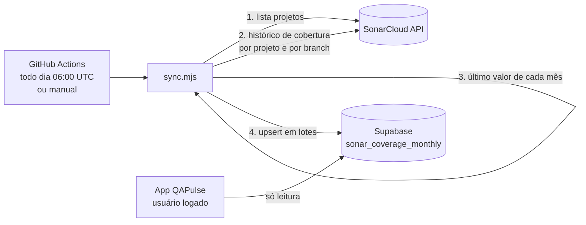

# SonarCloud: fluxo de sincronização com o Supabase

Como a cobertura de testes unitários chega do SonarCloud até a tela do QAPulse.

O fluxo tem três partes: um **job** no GitHub busca os dados no SonarCloud e os grava no **Supabase**, e o **app** só lê do Supabase. O app nunca fala com o SonarCloud.



## 1. Disparo

O workflow `.github/workflows/sonar-sync.yml` roda:

- todo dia às 06:00 UTC (agendamento);
- sob demanda, em Actions > Sync SonarCloud coverage > Run workflow.

Ele instala o Node 22 (sem `npm install`: o script só usa o `fetch` do Node) e executa `scripts/sonar-sync/sync.mjs`. Os secrets `SONAR_TOKEN`, `SUPABASE_URL` e `SUPABASE_SERVICE_ROLE_KEY` chegam ao script como variáveis de ambiente. A organização (`SONAR_ORG`), o filtro de projetos (`SONAR_PROJECT_FILTER`) e as branches extras (`SONAR_EXTRA_BRANCHES`) estão escritos no próprio workflow.

## 2. Buscar os dados no SonarCloud

O token vai no cabeçalho `Authorization` (Basic Auth, token como usuário e senha vazia), nunca na URL.

1. **Lista os projetos** com `projects/search`, da organização, filtrados pelo termo de `SONAR_PROJECT_FILTER`, de 500 em 500, com paginação. Cada projeto tem uma `key` e um `name`.
2. **Para cada projeto, lê o histórico de cobertura** com `measures/search_history`, métrica `coverage`, com paginação de 1000 pontos. Cada ponto é uma análise, com `date` e `value`. A leitura é feita:
   - na **branch principal** do projeto (em geral `master`);
   - e também nas **branches extras** de `SONAR_EXTRA_BRANCHES` (padrão `main`). Os pontos de todas são juntados.

Se o SonarCloud responder 429 ou erro 5xx, o script tenta de novo até duas vezes, com espera crescente. Para o motivo de ler duas branches, veja [sonarcloud-branches.md](sonarcloud-branches.md).

## 3. Reduzir ao último valor de cada mês

A função `lastValuePerMonth` (`src/custom-code/domain/sonar-coverage.ts`) agrupa os pontos por mês (`YYYY-MM`) e fica só com o de **data mais recente** em cada mês, venha de qual branch vier.

- Análises sem valor de cobertura são ignoradas.
- Meses sem análise não geram linha: nunca são preenchidos com valores de outros meses.
- O mês é lido do texto da data devolvida pelo SonarCloud, sem conversão de fuso horário.

O resultado, por projeto, é uma lista de linhas:

| Campo | Exemplo | Significado |
| --- | --- | --- |
| `project_key` | `acme_product-tech.app.server` | Chave do projeto no SonarCloud |
| `project_name` | `acme_product-tech.app.server` | Nome do projeto |
| `month` | `2026-10-01` | Primeiro dia do mês |
| `coverage` | `70.2` | Cobertura do último valor do mês, em % |
| `measured_on` | `2026-10-20` | Dia da análise que gerou o valor |
| `updated_at` | `2026-10-21T00:36:45Z` | Quando o job gravou a linha |

## 4. Gravar no Supabase

O script envia as linhas pela API REST do Supabase (PostgREST), com a chave secret, que ignora o RLS:

```text
POST <SUPABASE_URL>/rest/v1/sonar_coverage_monthly?on_conflict=project_key,month
Prefer: resolution=merge-duplicates
```

- O envio é em **lotes de até 500 linhas**.
- É um **upsert**: a linha de `(projeto, mês)` é criada se não existe e atualizada se já existe. Por isso rodar todo dia não duplica nada. Os meses fechados ficam iguais, e o mês corrente é atualizado com o último valor.

## 5. Como o app lê

- O app lê com o cliente do Supabase, usando a **chave pública e o token do usuário logado**. A policy do banco só permite leitura ao papel `authenticated`, e não existe policy de escrita para o app.
- O seletor de projetos usa a view `sonar_projects`, com um registro por projeto.
- O gráfico e a tabela leem os meses dos projetos selecionados e aplicam o filtro de período.

A tabela, a view e as policies estão em `supabase/schema.sql`.

## Como o código está dividido

Não há tabela temporária nem etapa intermediária de armazenamento: os dados passam **pela memória** do script, num único processo, e vão direto para o Supabase.

| Arquivo | Função | Papel |
| --- | --- | --- |
| `scripts/sonar-sync/sonar-client.mjs` | `listProjects()` e `getCoverageHistory()` | Chama a API do SonarCloud e devolve os dados como objetos |
| `src/custom-code/domain/sonar-coverage.ts` | `lastValuePerMonth()` | Função pura que reduz as análises ao último valor de cada mês (com testes unitários) |
| `scripts/sonar-sync/supabase-writer.mjs` | `upsert(rows)` | Recebe as linhas prontas e as envia ao Supabase |
| `scripts/sonar-sync/sync.mjs` | (orquestração) | Liga as três peças, trata erros e escreve o log |

O `sonar-client` não conhece o Supabase, e o `supabase-writer` não conhece o SonarCloud. Quem liga os dois é o `sync.mjs`. Por projeto, o laço faz:

```js
const history = [];
history.push(...(await sonar.getCoverageHistory(project.key)));        // 1. busca no SonarCloud
history.push(...(await sonar.getCoverageHistory(project.key, branch))); //    e na branch extra

const monthly = lastValuePerMonth(history);  // 2. reduz ao último valor de cada mês
const rows = monthly.map((m) => ({ /* project_key, month, coverage, ... */ })); // 3. monta as linhas
await writer.upsert(rows);                   // 4. grava no Supabase
```

`history`, `monthly` e `rows` são variáveis em memória: existem enquanto o projeto é processado e somem quando o laço passa para o próximo. O processamento é **projeto a projeto**, então cada um é gravado logo depois de lido, e o erro de um não perde o trabalho dos outros. Se o job falhar no meio, os projetos já gravados ficam no Supabase, e a próxima execução refaz tudo, porque o upsert é idempotente.

## Erros e logs

| Situação | O que o job faz |
| --- | --- |
| Token inválido (401) | Interrompe a execução e termina com falha |
| Projeto sem permissão ou não encontrado (403/404) | Registra um aviso e continua |
| Outro erro num projeto | Conta o erro, continua com os demais e termina com falha no fim |
| Projeto sem análise de cobertura | Pulado, sem erro |

No GitHub Actions o log sai em **modo silencioso** (`--quiet`, ativado por `GITHUB_ACTIONS`): só contagens, sem nomes de projetos nem percentagens, porque os logs de um repositório público são públicos. Localmente o log é completo.

Exemplo de resumo no fim da execução:

```text
Resumo: 112 processado(s), 15 pulado(s), 9 aviso(s), 0 erro(s), 853 linha(s) gravada(s).
```

## Como executar e conferir

- **No GitHub:** Actions > Sync SonarCloud coverage > Run workflow. O log mostra o resumo acima.
- **Localmente:** preencha o `.env` (modelo em `.env.example`) e rode `node --experimental-strip-types scripts/sonar-sync/sync.mjs`. Sem as variáveis do Supabase, ou com `--dry-run`, nada é gravado.
- **No banco:** a consulta `select max(updated_at), count(*) from public.sonar_coverage_monthly;` mostra a data da última gravação e o total de linhas. O `updated_at` é reescrito em toda execução.

Mais detalhes de configuração estão no `README.QAPulse.md`.
